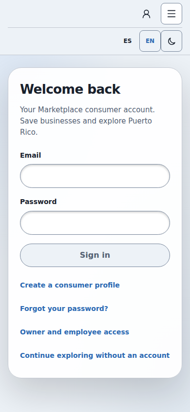
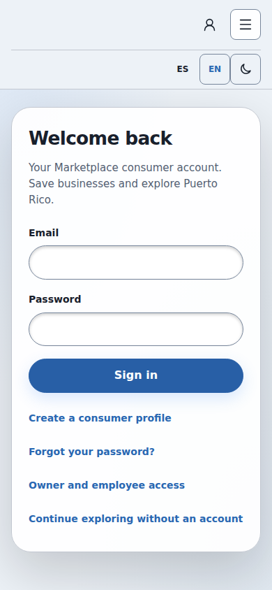
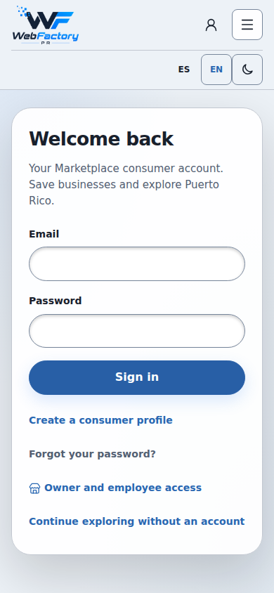
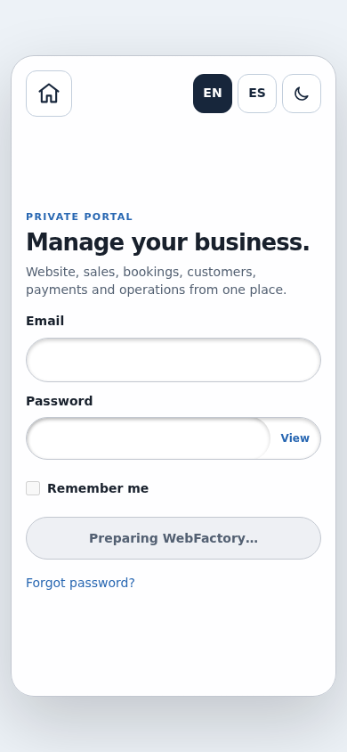
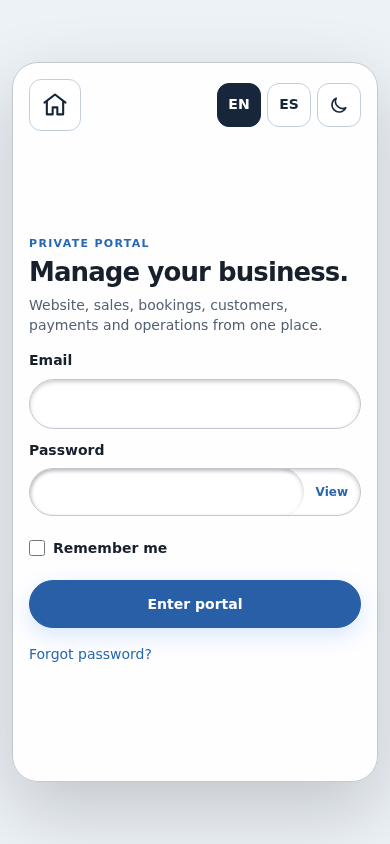
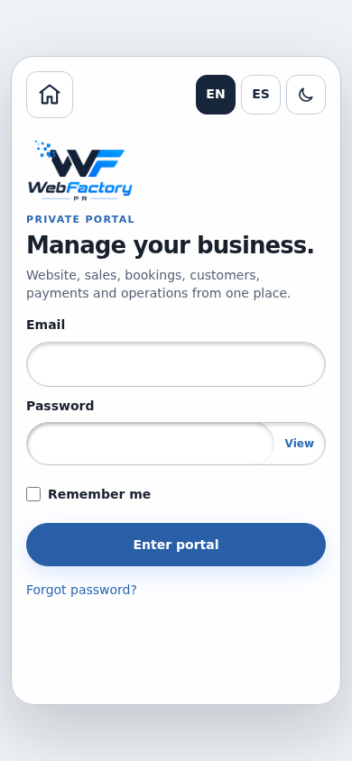

# Login paint, navigation and viewport investigation

Baseline: `ccac69223de833005b1adc80c6a53baca3f826ad`, the existing PR #125
preview. The baseline was checked out separately and served without modifying
its code. All authentication and directory requests were intercepted fixtures.
Evidence deliberately holds route CSS/JS and logo PNGs until the initial
loading screenshot has been recorded. Missing logos in a loading capture are
intentional network gating; the ready captures show the unchanged artwork.

## Demonstrated causes and fixes

1. `/cuenta` was not admitted by `usePortalNavigation`. Normal transitions into
   consumer access and from consumer access to the business portal reloaded the
   document. Adding the plain route uses the existing React transition/history
   mechanism. Query strings, hashes, confirmation/invitation/recovery tokens,
   external URLs and modified clicks retain their existing native handling.
2. The loading UI used spans/disabled styles with a grey action, whereas the real
   forms use blue buttons and native input typography/padding. Loading now uses
   the same form classes and native controls, with readonly unnamed text inputs,
   autocomplete off, an inert/aria-hidden preview form, and a disabled blue
   action. It cannot submit or accept credentials. Loading status is announced
   separately. Button labels share the real portal copy, so a long Preparing
   label cannot wrap and change the action height at 320 px. The three-bar
   indicator still runs during actual credential verification.
3. The Marketplace header grew when its original logo obtained its intrinsic
   dimensions. The approved logo slot now reserves its exact 1086/652 ratio;
   images fit that slot with no clipping, recoloring or source changes. The
   password visibility control's existing 12 px radius is also eager, instead
   of arriving with the lazy portal stylesheet.

The change does not replace layouts, hide the body, add waits to production,
force zoom, disable user zoom, or change authentication/MFA/tenant permissions.

## Recorded before/after

| Measurement | Baseline | Corrected |
| --- | --- | --- |
| Documents requested during `/ → /cuenta → /client-admin → /webfactory-admin` and Back/Forward | 6 | 1 |
| Consumer card top while logo is withheld → ready, 390 px | 138 → 152.828 px | 152.828 → 152.828 px |
| Consumer loading action → ready | grey → blue | blue → blue |
| Business loading action → ready | grey → blue | blue → blue |
| Phone innerWidth / clientWidth / visualViewport.width / scale | 390 / 390 / 390 / 1 | 390 / 390 / 390 / 1 |
| Desktop-requested test width | 980 / 980 / 980 / 1 | 980 / 980 / 980 / 1 |

Full recorded values, including dimensions, field fonts/padding, colors,
shadows, viewport height, document identity, history and orientation stages:
[measurements.json](evidence/login-paint/measurements.json).

### Consumer access

Before loading:

After loading (same logo gate):

After ready:

### Business access

Before loading:

After loading (same logo gate):

After ready:

## The small desktop-looking view in the recording

The HTML actually served at `/`, `/cuenta`, `/crear`, `/client-admin/` and
`/webfactory-admin/` already contained exactly one correct viewport tag:
`width=device-width, initial-scale=1.0, viewport-fit=cover`. Generated entry
shells preserve it. In mobile Chromium and WebKit the measured viewport is
390 px at scale 1, without horizontal overflow. At an explicitly supplied
980 px viewport, the site appropriately uses that wider layout.

The physical iPhone's desktop-site/zoom preference cannot be read from the
recording. A desktop-width viewport reduced onto a phone is consistent with its
appearance, but is not a proven setting on that device. We did not reproduce
that miniature view with a correctly configured mobile viewport, and did not
add a forced zoom reset to claim otherwise. The verified fixes remove the
measured paint changes and avoid document reloads in the normal route chain.

## Validation

- Build/TypeScript and 811 Node tests.
- Full style and bounds parity while route CSS/JS and PNGs are withheld:
  36 cases each in Chromium and WebKit (three logins, widths 320/390/980,
  ES/EN and Light/Dark). Preview controls must be inert/readonly/unnamed;
  real email/password controls retain editing and autocomplete.
- Navigation/history matrix: 32 Chromium cases across
  320/375/390/430/768/980/1024/1440; eight WebKit cases at 390/980.
  Added orientation passes for each login at 390/980 on both engines.
  Signup queries and invitation/recovery/confirmation hash callbacks retain
  their full navigation and consume isolated fixture tokens without writes.
- Existing commercial control/field geometry: 64 cases; consumer loading and
  signup geometry: 56; shared login 401/503/retry: 84; consumer account flow:
  28 plus unavailable registration; viewport/keyboard/MFA/logout: six;
  recovery/usability: 32 plus failure/retry/session/Builder; MFA contrast and
  restored passkey/Authenticator/recovery states: four.
- Captures above and the attached measurements were regenerated from the
  baseline checkout and corrected build before publication.

These are real browser-engine runs with intercepted requests, not a physical
Safari/iPhone test or a live password, passkey-provider or email-delivery test.
Deployment is limited to the existing draft PR #125 preview.
